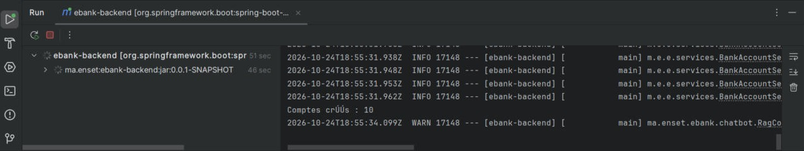
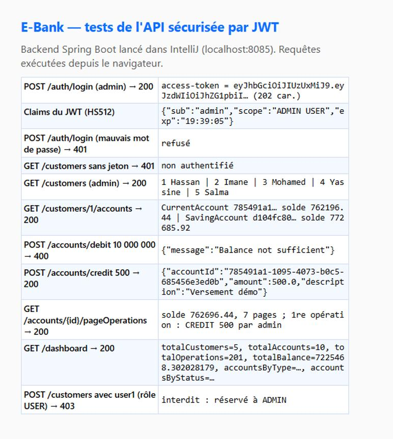
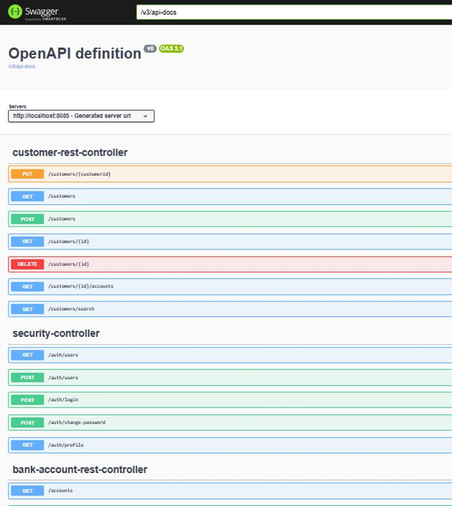

# Projet E-Bank : Spring Boot, Angular, JWT et chatbot RAG

**Mohammed ELJIHAD**, Master II-BDCC, ENSET Mohammedia. Module : Architecture JEE et Systèmes Distribués (Pr. Mohamed YOUSSFI).

Application de gestion de comptes bancaires. Chaque compte appartient à un client et peut subir des opérations de **DEBIT** ou de **CREDIT**. Il existe deux types de comptes : **comptes courants** (avec découvert) et **comptes épargne** (avec taux d'intérêt). L'application est sécurisée par **Spring Security et JWT**. Elle intègre un **agent conversationnel** basé sur le RAG (Spring AI) et accessible depuis l'application Angular et depuis **Telegram**.

```
ebank-spring-angular-jwt/
├── ebank-backend/    Spring Boot 3.4 · Spring Data JPA · Spring Security (OAuth2 Resource Server / JWT HS512)
│                      Spring AI 1.0 (OpenAI, RAG, tools) · Telegram Bots · Swagger (springdoc)
└── ebank-frontend/   Angular 18 · Bootstrap 5 · ng2-charts (Chart.js) · jwt-decode
```

## Architecture
```
 Angular (4200) ── HTTP + "Authorization: Bearer <JWT>" ──> Spring Boot (8085)
   login / dashboard / clients / comptes / chatbot          │ SecurityFilterChain (JWT)
                                                             ├─ RestControllers ─> Services (@Transactional) ─> DTO / Mappers
                                                             │                                   └─> Repositories JPA ─> H2 / MySQL
 Telegram ───────────────────────────────────────────────> ├─ TelegramBot ─┐
                                                             └─ /chat ────────┴─> ChatbotService (Spring AI ChatClient)
                                                                                    ├─ QuestionAnswerAdvisor (RAG, SimpleVectorStore)
                                                                                    └─ BankTools (@Tool : clients, comptes, statistiques)
```

## Partie 1 : backend
1. **Projet Spring Boot** : Web, Data JPA, H2/MySQL, Lombok, Validation, Security, OAuth2 Resource Server et springdoc-openapi.
2. **Entités JPA** :

   | Entité | Description |
   |---|---|
   | `Customer` | id, name, email, createdBy |
   | `BankAccount` (abstraite) | héritage **SINGLE_TABLE** (`@DiscriminatorColumn TYPE`) : id UUID, balance, createdAt, status, createdBy, customer |
   | `CurrentAccount` (`CA`) | overDraft |
   | `SavingAccount` (`SA`) | interestRate |
   | `AccountOperation` | operationDate, amount, type (DEBIT/CREDIT), description, performedBy |

3. **Repositories Spring Data** :
   - `CustomerRepository.searchCustomer` (JPQL) ;
   - `BankAccountRepository.findByCustomerId` ;
   - `AccountOperationRepository.findByBankAccountIdOrderByOperationDateDesc(…, Pageable)`.
4. **Test de la couche DAO** : `EbankApplication` crée 5 clients, puis 2 comptes par client, puis 20 opérations aléatoires par compte.
5. **Couche service et DTO** :
   - `BankAccountService` regroupe les clients (CRUD et recherche), les comptes (création, statut) et les opérations (débit avec contrôle du solde et du découvert, crédit, virement), ainsi que l'historique paginé et le tableau de bord.
   - `BankAccountMapperImpl` convertit les entités en DTO, ce qui évite d'exposer les entités et les cycles JSON.
   - Les exceptions métier sont `CustomerNotFoundException`, `BankAccountNotFoundException` et `BalanceNotSufficientException`. `GlobalExceptionHandler` les traduit en codes HTTP 404 et 400.
6. **RestControllers** :

   | Méthode | URL | Rôle |
   |---|---|---|
   | GET | `/customers`, `/customers/search?keyword=`, `/customers/{id}`, `/customers/{id}/accounts` | USER |
   | POST / PUT / DELETE | `/customers`, `/customers/{id}` | ADMIN |
   | GET | `/accounts`, `/accounts/{id}`, `/accounts/{id}/operations`, `/accounts/{id}/pageOperations?page=&size=` | USER |
   | POST | `/accounts` (CURRENT/SAVING), `/accounts/debit`, `/accounts/credit`, `/accounts/transfer` | ADMIN |
   | PATCH | `/accounts/{id}/status?status=ACTIVATED\|SUSPENDED` | ADMIN |
   | GET | `/dashboard` | USER |
   | GET | `/chat?query=` | USER |

7. **Tests des web services** : la documentation Swagger UI est disponible sur `http://localhost:8085/swagger-ui.html` (bouton *Authorize* pour coller le JWT).

## Partie 2 : client Angular
| Page | Fonctionnalités |
|---|---|
| Login | formulaire réactif ; le JWT est décodé (`jwt-decode`) et conservé dans le localStorage pour restaurer la session |
| Dashboard | indicateurs (clients, comptes, opérations, encours) et 4 graphiques **Chart.js** : opérations par mois (crédits/débits), répartition par type, statuts, top 5 clients par solde |
| Clients | recherche, édition, suppression avec confirmation, accès aux comptes du client |
| Comptes d'un client | liste, création d'un compte courant ou épargne, activation ou suspension |
| Comptes | consultation par identifiant, historique paginé, formulaire DEBIT / CREDIT / TRANSFER |
| Assistant | chat avec l'agent RAG, avec des suggestions de questions |
| Utilisateurs (ADMIN) | liste et création des utilisateurs |
| Mon compte | changement du mot de passe |

L'`appHttpInterceptor` ajoute `Authorization: Bearer …` à chaque requête et déconnecte l'utilisateur sur une erreur 401. `authenticationGuard` protège l'espace `/admin`, et `authorizationGuard` réserve certaines routes au rôle ADMIN (via `data.role`). Les boutons d'administration sont masqués selon les rôles.

## Partie 3 : sécurité (Spring Security et JWT)
- `POST /auth/login` (username/password) : l'`AuthenticationManager` vérifie l'utilisateur en base (`UserDetailsServiceImpl`, mot de passe **BCrypt**) puis renvoie `{"access-token": "<JWT>"}`. Le jeton est signé **HS512** par `NimbusJwtEncoder`, avec les claims `sub`, `scope` = rôles et `exp` = 30 min.
- **Mode stateless** : pas de session, CSRF désactivé, CORS ouvert pour `http://localhost:4200`. `oauth2ResourceServer().jwt()` valide la signature et l'expiration de chaque requête.
- **Autorisations** : `@EnableMethodSecurity` avec `@PreAuthorize("hasAuthority('SCOPE_USER')")` pour la consultation et `hasAuthority('SCOPE_ADMIN')` pour la gestion.
- **Gestion des utilisateurs** :
  - entités `AppUser` et `AppRole` en base ;
  - `POST /auth/change-password` permet à un utilisateur de changer son mot de passe (ancien mot de passe vérifié) ;
  - `GET`/`POST /auth/users` sont réservés à l'administration.
- **Traçabilité** : chaque client, compte et opération enregistre l'identifiant de l'utilisateur authentifié (`createdBy` / `performedBy`, lu dans le `SecurityContext`, donc dans le `sub` du JWT).

Comptes initiaux : `admin` / `1234` (USER, ADMIN) et `user1` / `1234` (USER).

## Parties 4 et 5 : chatbot (RAG, agent et Telegram)
- **RAG** :
  - au démarrage, `ebank-guide.md` (types de comptes, statuts, frais, plafonds, procédures) est découpé par `TokenTextSplitter`, vectorisé avec les embeddings OpenAI `text-embedding-3-small`, puis indexé dans un `SimpleVectorStore` ;
  - le `QuestionAnswerAdvisor` injecte les passages pertinents dans le prompt.
- **Agent** : grâce aux méthodes `@Tool` de `BankTools`, le modèle (`gpt-4o-mini`) peut interroger les **vraies données** : rechercher un client, lister ses comptes, consulter le solde et les dernières opérations d'un compte, obtenir les statistiques.
- **Clients du chatbot** : `TelegramBot` (long polling) relaie chaque message Telegram vers l'agent. Dans l'application Angular, la page *Assistant* appelle `GET /chat`.
- **Secrets** : la clé OpenAI n'est **jamais** écrite dans le dépôt. Elle est lue dans la variable d'environnement `OPENAI_API_KEY` (voir `.env.example`). Le bot Telegram ne démarre que si `TELEGRAM_BOT_TOKEN` est défini.

## Lancement
```bash
# Backend
cd ebank-backend
export OPENAI_API_KEY=...            # Windows : set OPENAI_API_KEY=...
export TELEGRAM_BOT_TOKEN=...        # optionnel (créé avec @BotFather)
mvn spring-boot:run                  # http://localhost:8085 (H2) ; profil MySQL : -Dspring-boot.run.profiles=mysql

# Frontend
cd ebank-frontend
npm install
npm start                            # http://localhost:4200
```

## Captures
Backend lancé dans IntelliJ (`spring-boot:run`, port 8085) ; requêtes réelles envoyées à l'API.

| Capture | Description |
|---|---|
|  | Démarrage dans IntelliJ : 10 comptes créés au seed ; RAG désactivé sans `OPENAI_API_KEY` |
|  | Scénario de test : login JWT (HS512), 401 sans jeton, clients, comptes, débit refusé (solde insuffisant), crédit, historique, dashboard, 403 pour `user1` |
|  | Swagger UI : endpoints clients, sécurité et comptes |

> Le frontend Angular et le chatbot (OpenAI, Telegram) nécessitent Node.js et une clé `OPENAI_API_KEY` : sans clé, `/chat` renvoie un message explicite au lieu d'une erreur.

## Conclusion
- Le projet assemble une architecture complète :
  - un backend en couches (entités, DTO, services, contrôleurs REST) ;
  - une sécurité stateless par JWT ;
  - un frontend Angular modulaire avec guards et intercepteur.
- Il ajoute une brique d'IA générative : un agent RAG qui combine une base documentaire et des outils métier, et qui est accessible à la fois depuis l'interface web et depuis Telegram.
